<div align="center">
  
[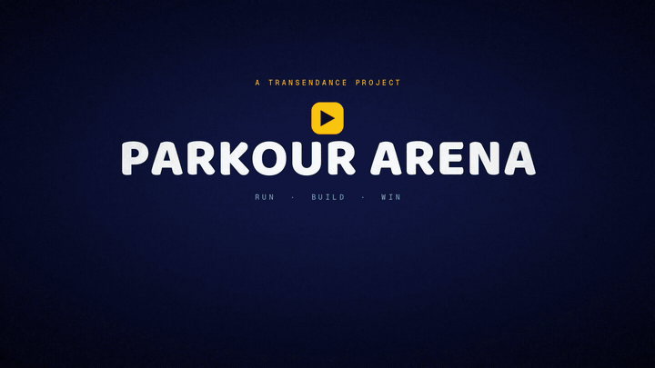](#trailer)
  
# Transcendence-WebGameEngine

*One course in the sky, one life each, and zero installs.*


</div>

Four of us built this for the 42 transcendence project. A course floats in the
sky, every player gets one life, and the last one still standing wins.

Most of the work went under the game, into **ThreeWrapper**, our engine on top
of Three.js. The lobby, the course, the map editor and the other tools all run
on it.

## What's in the box

| | |
|---|---|
| **The match** | 3D battle royale in a browser tab — one life, last one standing |
| **The course** | four maps as YAML: city rooftops, foundry, frost spires, canopy |
| **The engine** | ThreeWrapper on Three.js and Rapier: `World → Environment → Module` |
| **The tools** | component creator, map editor, hitbox and noclip views, live inspector |
| **The stack** | Next.js, Bun WebSocket, Go API, PostgreSQL — five containers behind nginx |
| **The demo** | `make up`, seeded Lio / Tommy / Ella accounts, browser only |

## Trailer

https://github.com/user-attachments/assets/f1a2e92e-13d9-4c53-ab31-90d7b12418cb

## The interface

Sign-in is one page for email or 42, with a real consent step. The local demo
fakes the 42 screen, so sign-up works without an outside account.

<table>
<tr>
<td width="50%">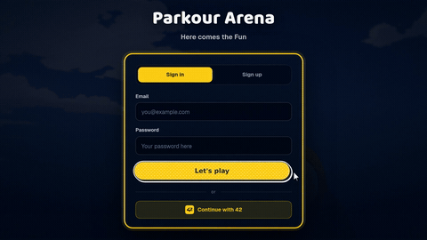</td>
<td width="50%">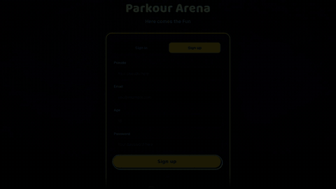</td>
</tr>
</table>

**Past the door, the lobby is the hub.** Friends, global chat, the customiser
and the leaderboard are panels over the same 3D room, so the menu never leaves
the game.

<table>
<tr>
<td width="50%">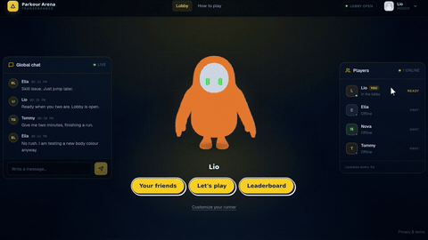</td>
<td width="50%">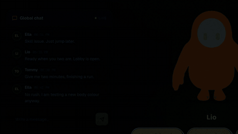</td>
</tr>
<tr>
<td width="50%">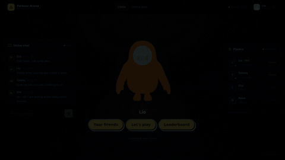</td>
<td width="50%">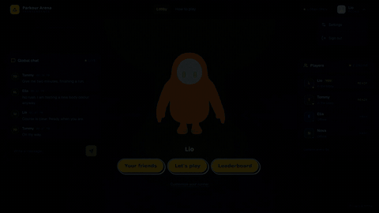</td>
</tr>
</table>

<p align="center">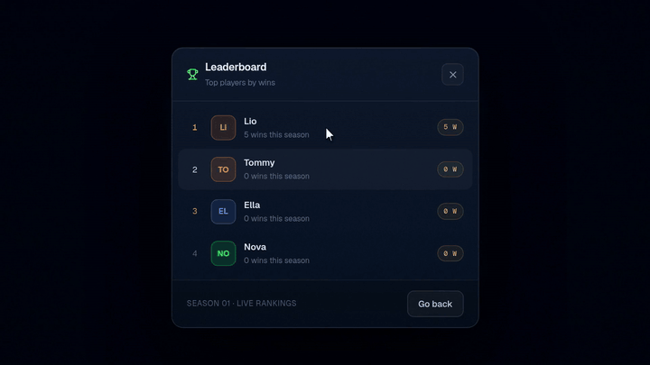</p>

## Gameplay

<p align="center"><video src="https://github.com/user-attachments/assets/67b837c6-c5f9-485e-ab75-b8c68453cdac" controls></video></p>

**A match is a YAML script.** Wait, load, briefing, game, results — lives,
quorum and timeouts are fields. Changing the script changes the rules, and the
networking code does not move.

## The game engine

The course is not a scene file. It is a **world**: an environment (sky, fog,
lights) plus the modules that run inside it. Home, lobby, course and the
editors share one lifecycle.

```text
1.engine/       render loop, canvas, server bridge
2.world/        worlds, components, physics, tools
3.environment/  skies and lighting presets
4.module/       input, UI, gameplay, network, editors
```

**`World` → `Environment` → `Module` is the whole contract.** A world applies
an environment, the environment registers its modules, and the engine ticks the
result. Disposal runs in reverse: a missed listener or physics body outlives
the world and breaks the next round, so teardown is written before anything
is drawn.

<p align="center">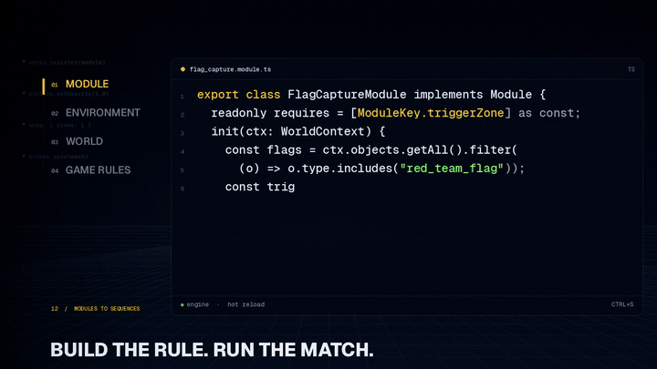<br><sub><b>World code.</b> A mode as a module, an environment, a world and a rules file.</sub></p>

**The tools are modules too.** The component creator, the map editor, the
hitbox and noclip views and the debug overlay all register on the same
lifecycle. A new tool is a module; a new course is YAML.

<table>
<tr>
<td width="50%">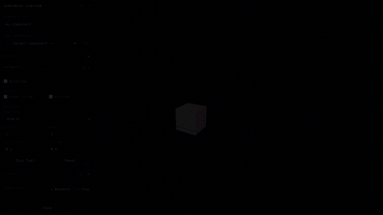<br><sub><b>Component creator.</b> Meshes, physics body, collisions and hitboxes, previewed as you edit; Drop Test runs the body.</sub></td>
<td width="50%">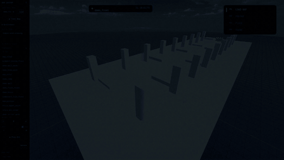<br><sub><b>Map editor.</b> Place components, rotate, undo, save the course to YAML.</sub></td>
</tr>
<tr>
<td width="50%">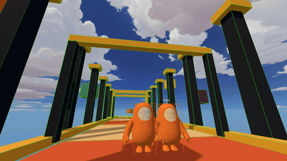<br><sub><b>Hitboxes.</b> Collision shapes drawn over the live scene.</sub></td>
<td width="50%">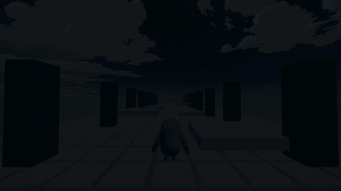<br><sub><b>Noclip.</b> Fly the camera through geometry to inspect a build.</sub></td>
</tr>
</table>

<p align="center">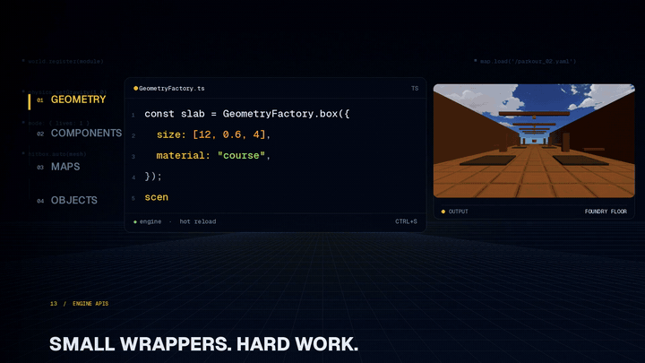<br><sub><b>Engine APIs.</b> Geometry, components, maps and objects, one call each.</sub></p>

**F1 opens the debug panel.** Logs, a world inspector, visual debug, network
and engine controls sit in one overlay. The inspector edits live transforms,
clones objects and freezes them, and shows the player data the server sends.

<p align="center">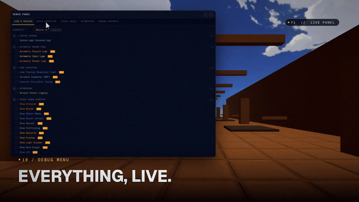</p>

Everything above comes from the same engine: a new mode is a module, a new
course is YAML, and a new component is a mesh plus a physics body. The city,
the foundry, the frost course and the rooftop in the trailer were built with
these tools.

## How it fits together

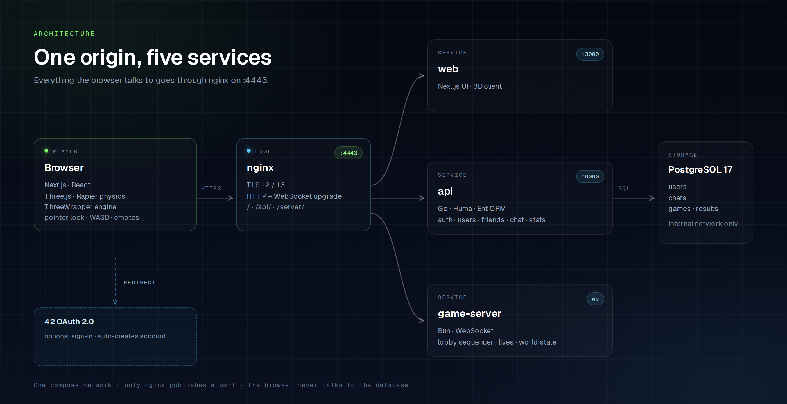

nginx is the only published port. It ends TLS, upgrades `/server` to the Bun
game server, forwards `/api` to Go and serves Next.js. Postgres only exists on
the compose network, and cookies, TLS and the 42 redirect all use the same
host, so nothing has to special-case localhost.

The game server rebroadcasts the room at 20 Hz. Your own movement runs on your
machine so the keys feel immediate; everyone else is smoothed between
snapshots. The server relays positions, it does not simulate physics.

## Run it

Docker with Compose. `localhost:4443` is the public host, `db` is `DB_HOST`,
and the mail values can be anything: the demo script creates already-verified
accounts.

```bash
cp .env.dev.example .env
make up                     # self-signed cert + five services
./create_demo_users.sh      # Lio, Tommy, Ella (password = username)
```

Open https://localhost:4443, accept the certificate, and sign in as
`Lio@example.com` / `Lio`. `DB_PORT=5432` is both the published port and the
port inside the compose network.

Third-party models are not shipped with the repository: download them and drop
them in `front/public/game/` as described in [`ASSETS.md`](ASSETS.md), otherwise
maps and the player body render empty.

## Rough edges

- The standalone `/character-customizer` route still shows an untextured model
  and a torso seam; the customiser clip above predates that route and is
  unaffected.
- With the demo SMTP service down, signup returns `500`. The frontend fallback
  only matches an exact-case email.

## Layout

```text
Transcendence-WebGameEngine/
├── front/              Next.js app + the ThreeWrapper engine
│   ├── app/            login, home, online, rules, map-editor, component-creator
│   ├── ThreeWrapper/   numbered engine layers
│   │   ├── 1.engine/       render loop, canvas, server bridge
│   │   ├── 2.world/        worlds, components, physics, tools
│   │   ├── 3.environment/  skies and lighting presets
│   │   └── 4.module/       input, UI, gameplay, network modules
│   ├── public/game/    maps, components, local assets (see ASSETS.md)
│   └── public/         icons, lottie assets, app images
├── server/             Bun WebSocket server + YAML lobby configs
├── backend/            Go API (Chi, Huma, Ent) + PostgreSQL schema
├── shared/             protocol, config and state types for both TS sides
├── docs/               trailer, clips, architecture
├── nginx/              TLS termination and path routing
└── compose.yaml        five services, one network
```

The numbers are my own convention, not a 42 rule. `1.engine` → `4.module`
follows the build order, so the layout reads like the architecture.

## Credits

42 Paris, by **Alix**, **Tristan**, **Shiyan Guan** and **Edouard**
([@edouwarden](https://github.com/edouwarden)).

Third-party 3D models and textures are **not distributed** with this repository.
[`ASSETS.md`](ASSETS.md) lists the models used for the demo, their authors and
licenses, where to place them locally, and which ones must be replaced before a
public release.

This is a non-commercial student project made for educational purposes. It is
not affiliated with or endorsed by Epic Games. "Fall Guys" and all related
characters and marks are trademarks of their respective owners; all rights to
the assets remain with their authors. Screenshots, GIFs and the trailer were
recorded with third-party assets present and are kept for demonstration only.
